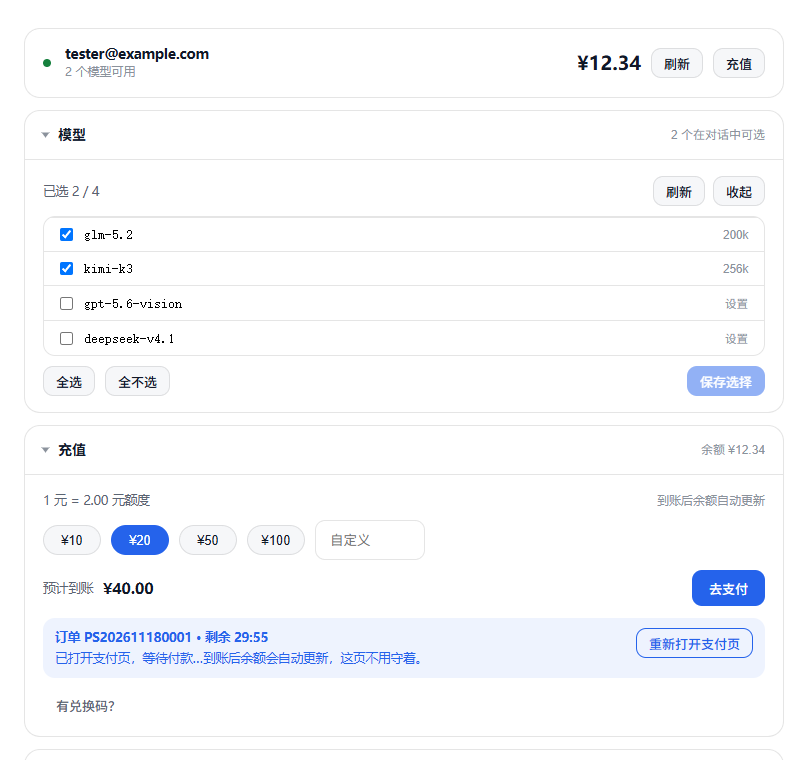
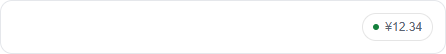

# dsh-sub2api

把自建的 **Psapi**（`sub.pscly.cc`，网关软件是开源的 [sub2api](https://github.com/Wei-Shaw/sub2api)）接进 DeepSeek Harness（DSH）。

装完之后，在 **设置 → Psapi** 里填一次邮箱和密码就能用：插件自己判断该登录还是注册，注册后自动创建名为 `dsh` 的 API 密钥、写进本机凭据库，并把上游模型同步进模型选择器。余额、用量、订阅、兑换码、充值和技术支持都在同一个面板里。

```
npm:  dsh-sub2api          https://www.npmjs.com/package/dsh-sub2api
repo: pscly/dsh-sub2api    https://github.com/pscly/dsh-sub2api
安装: dsh plugin add dsh-sub2api      需要 DSH ≥ 0.2.2-rc.1，装完重启 DSH
```



装好之后你不需要碰任何接口地址或密钥：**邮箱 + 密码**就够了。插件自己判断该登录还是注册，
在账号下建一个名为 `dsh` 的密钥存档，把模型同步进选择器，并把余额、用量、订阅、兑换码、
充值集中在一个面板里。

---

## 它解决什么

手动接一个中转站要四步：拿账号 → 去后台建 Key → 把 Key 粘进设置 → 记住模型名。任何一步错，用户就卡住了。

| 手动接入 | 本插件 |
|---|---|
| 注册账号（可能要跳浏览器） | 面板里填邮箱密码 |
| 去后台创建 API Key 并复制 | 自动创建名为 `dsh` 的密钥 |
| 把 Key 粘贴到设置页 | 自动写入凭据库 |
| 手填 baseUrl 和模型列表 | 自动同步 `/v1/models` |
| 出问题自己猜 | 「运行诊断」直接指出坏在哪一项 |

## 安装

### npm（推荐）

```sh
dsh plugin --profile web add dsh-sub2api
```

也可以直接在 **插件 → 添加插件** 里搜 `dsh-sub2api`。

重启后打开 **设置 → Psapi**。

### 从 GitHub 装

```sh
dsh plugin --profile web add github:pscly/dsh-sub2api#v0.2.0
```

### DSH Desktop

Desktop 用的就是官方 Harness 插件体系，本插件只依赖官方契约（`llm` / `webServer` / `tools` / `commands` / `slots`），在桌面端原样可用。

托盘菜单打开的终端里，裸命令默认作用于当前激活的 profile：

```sh
dsh plugin add dsh-sub2api
```

装完**必须重启 DSH Desktop**，新的 bundle 才会进入 Loader 组合。

| Desktop 通道 | 内置 DSH | 本插件 |
|---|---|---|
| stable | 0.2.1-rc.3 | ✅ |
| beta | 0.2.2-rc.3 | ✅ |
| next | 0.2.2-rc.3 | ✅ |

插件声明 `>=0.2.1-rc.2 <0.2.3`，并固定 `@dsh-ai-providers/openai-compatible@0.7.0`——这个版本同时接受 0.2.1 与 0.2.2 两个通道。

插件市场的一键安装要求：单一 npm 包名、官方 registry 的 `latest` 是稳定版本、包内声明 `dsh.bundle.patch`。三条都满足。

---

## 内置模型与默认模型

安装后有两件事自动发生：

**1. DSH 的默认模型被改成 `sub2api/deepseek-flash`**

写进 profile 配置（`agent-default-model`），重启后依然生效。**只做一次** ——
你之后手动换成别的 provider，插件不会再抢回来。

**2. 永远自带一个 `deepseek-flash`**

零余额账号请求 `/v1/models` 会拿到 `403 INSUFFICIENT_BALANCE`，以前结果是模型选择器**完全空白**，装完像坏了一样。现在无论有没有余额、有没有同步成功，列表里至少有一个 `deepseek-flash`（上下文 1,048,576，实测值）；上游真的返回后，真实目录会覆盖它。

面板里它带一个「内置」标签，避免被误认为是上游列出来的。

## 聊天输入框右下角的余额徽章

插件在对话输入框的右下角（`conversation.input.right`）常驻一个小徽章：



```
● ¥12.34            正常
● ¥3.00             偏低（< 5 元，琥珀色）
● ¥0.00  去充值      余额为零（红色，点击直达支付页）
```

- 鼠标悬停显示详情：账号、可用模型数、是否待充值
- 余额正常时点击 = 刷新；余额为零时点击 = 打开支付页
- 未登录时不渲染，不占位
- 与设置页共用**同一份**状态和轮询（45 秒一次），不会重复请求

## 面板

打开就是一行状态：**连接状态、余额、可用模型数**，右边两个按钮「刷新」「充值」。下面按需要展开：

| 区块 | 默认 | 里面有什么 |
|---|---|---|
| 模型 | **展开** | 已选几个、刷新、管理（勾选 + 逐模型上下文容量） |
| 充值 | 余额为 0 时自动展开 | 金额预设、预计到账、去支付、兑换码（默认收起） |
| API 密钥 | 收起 | 掩码、复制、重建 |
| 账户与用量 | 收起 | 今日/累计用量、订阅进度条、退出登录 |
| 诊断 | 收起 | 六项检查 |

操作有回执：复制、刷新、保存选择、兑换、重建密钥都会在右上角弹一条提示；每个按钮只管自己的忙碌状态，不会因为别处刷新就整页变灰。

### 账户

邮箱、余额、今日/累计用量，以及订阅进度条（日/周/月）。并发数不展示（站点侧也已对用户隐藏）。未登录时是登录表单：一个邮箱 + 一个密码 + 一个「继续」按钮。

**一个表单两种结果**：先试登录，只有「凭据错误」才自动注册。所以

- 新邮箱 → 注册 → 直接进入
- 老邮箱密码对 → 登录
- 老邮箱密码错 → 提示「这个邮箱已注册，密码不正确」，**不会重复建号**

### API 密钥

显示掩码，点「复制」才临时取回明文。密钥名固定为 `dsh`；再次点击是**轮换**（新建成功后才删除旧的），不是堆一堆。

### 余额与充值

金额预设 + 自定义，按 `1 元 = 2 元额度` 实时显示预计到账（倍率来自配置，不是写死的）。点「去支付」在新标签页打开支付页，付款后自动轮询状态并刷新余额。下方是兑换码入口。

### 模型

- 列出**全部**上游模型，勾选决定对话里显示哪些（全部勾选 = 不做限制）
- 容量数字可点，手动改这个模型的上下文窗口
- 超过 8 个模型时出现搜索框
- 显示容量来源：无标记=上游声明，`实测`=内置实测表，`默认`=兜底值，`手填`=你自己改的

### 诊断

一键跑六项检查：登录状态、访问令牌、API 密钥、账号资料、余额、密钥分组、模型目录。失败的那一项直接标出原因，不用在几个卡片之间猜。

---

## 思考等级

模型的思考档位由适配器**声明**，宿主只认声明过的 id——没声明就完全没有这个控件。插件对下列家族声明四档 `reasoning_effort`（极低 / 低 / 中 / 高）：

`deepseek-v4*`、`deepseek-flash`、`deepseek-reasoner`、`deepseek-r1`、`gpt-5*`、`o3*`、`o4*`

其它模型默认不给档位，因为无法确认上游认不认这个字段（认不出会忽略、也可能直接 400）。要让某个模型也出现档位，在配置里加：

```yaml
llm-sub2api:
  reasoningModels: ["glm-5", "kimi-k3"]   # 按 id 片段匹配
  defaultReasoningEffort: medium            # 可选，留空则用上游默认
```

选中的档位会以 `{"reasoning_effort": "<id>"}` 合并进请求体，和采样参数走同一条路径。面板的模型列表里，支持档位的模型会标注「思考 4 档」。

## 命令与工具

```
/sub2api           账号、密钥、余额、模型数量
/sub2api models    列出对话里可选的模型
/sub2api balance   余额与订阅
/sub2api recharge  充值入口
/sub2api help      用法
```

Agent 工具（只读）：`sub2api_status`、`sub2api_models`。模型可以回答「我还有多少额度」，但不会替你花钱。

---

## 配置

插件行写在 `$DSH_HOME/profiles/<profile>/cordis.patch.yml`：

```yaml
- id: llm-sub2api
  name: "dsh-sub2api"
  config:
    apiBase: "https://sub.pscly.cc"
    payBase: "https://pay.pscly.cc"
    apiKeyEnv: SUB2API_API_KEY
```

| 字段 | 默认值 | 说明 |
|---|---|---|
| `apiBase` | `https://sub.pscly.cc` | 中转站地址，末尾 `/v1` 会被去掉 |
| `payBase` | `https://pay.pscly.cc` | 充值中转站地址 |
| `apiKeyEnv` | `SUB2API_API_KEY` | 存 API Key 的凭据引用名 |
| `keyName` | `dsh` | 自动创建/复用的密钥名 |
| `groupId` | 自动选择 | 强制指定密钥所属分组 |
| `requestTimeoutMs` | 300000 | 普通请求超时 |
| `streamIdleTimeoutMs` | 300000 | 流式请求空闲超时 |
| `modelsCachePath` | `$DSH_HOME/sub2api-models.json` | 模型目录缓存 |
| `panelPath` | `$DSH_HOME/sub2api-panel.json` | 面板状态（可见模型 + 手填容量） |
| `visibleModels` | 全部 | 运营方统一指定可见模型（优先于面板选择） |
| `contextWindow` | 逐模型解析 | 强制覆盖**所有**模型的上下文窗口 |
| `defaultContextWindow` | 128000 | 上游未声明时的兜底值 |
| `rechargeMultiplier` | 2 | 每 1 元到账多少额度，仅用于面板预估；实际到账由支付站决定 |
| `showSidebarQuota` | false | 侧边栏余额卡片 |
| `autoProvision` | true | 登录后自动建 Key |
| `announceToAgent` | true | 向 agent 注入插件说明 |

---

## 三个必须知道的机制

### 1. 密钥分组

网关会拒绝**没有分组的密钥**（`API key is not assigned to a group`），所以自动选择必须有确定结果：

1. 配置里的 `groupId`
2. 账号 `allowed_groups` 里能匹配到的组
3. 只有一个组时就用它
4. 多个组时优先 `platform` 为 `openai` 的组（中间层走 `chat/completions`，别的平台服务不了）
5. 否则取第一个非独占组

### 2. 余额为 0 拿不到模型，到账后自动同步

Psapi 的网关对 `/v1/models` 有余额门槛，零余额直接 `403 INSUFFICIENT_BALANCE`：

```
[200] POST /api/v1/keys         → 正常返回明文 key
[403] GET  /v1/models           → {"code":"INSUFFICIENT_BALANCE"}
[200] GET  /v1/sub2api/billing  → 正常（Key 绑分组后）
[404] GET  /api/v1/models       → 控制面没有模型接口
```

插件把它当作**待充值状态**而不是错误：面板显示「余额不足，暂时拿不到模型列表」+「去充值」。

**充值到账后不需要手动刷新**：面板每 45 秒静默读一次状态，宿主机发现余额从 0 变成正数且目录仍为空时，会自己重新拉一次模型并通知选择器。失败后有两分钟退避，避免空分组被反复重试。

> 运营建议：给新用户送一点初始余额，否则注册完第一屏必然是空的。

### 3. 上下文窗口

DSH 切换模型前要算容量，拿不到就拒绝：

```
Cannot switch to sub2api/...: no context capacity; configure contextWindow on that adapter model
```

`/v1/models` 是上游响应透传，多数上游不带 `context_length`，所以插件逐级回退：

1. 配置 `contextWindow`（全局）
2. 面板里手填的单模型值
3. 上游声明
4. 内置实测表（`deepseek-flash` / `deepseek-v4.1-flash` = 1,048,576，来自本站实测）
5. `defaultContextWindow`（默认 128000）

**填大了上游会 400，填小了会提前压缩**——拿不准就用面板里的手填值和诊断确认。

---

## 数据与安全

| 数据 | 位置 | 权限 |
|---|---|---|
| 登录会话（token） | DSH 凭据库 record `llm-sub2api/session` | 0600 |
| API Key | 凭据引用 `SUB2API_API_KEY` | 0600 |
| 模型目录缓存 | `$DSH_HOME/sub2api-models.json` | 0600 |
| 面板状态 | `$DSH_HOME/sub2api-panel.json` | 0600 |
| 密码 | **不保存** | — |

- 所有 `/api/sub2api/*` 路由只接受本机回环请求，非本机一律 403。
- 日志与错误信息不含 token、密钥或密码；错误体里的对象会被解包成可读文案，不会出现 `[object Object]`。
- 支付链接里的 `token` 只在用户点「去支付」时生成，不落盘、不写日志。

---

## 上下文窗口从哪来

网关的 `/v1/models` **只返回模型 id，一个容量字段都没有**（46 个模型全是这样）。所以插件必须自己知道这些数字，
否则每个模型都只能按默认值显示——这也是「有些模型居然只有 128k」的原因。

容量按这个顺序解析：

| 优先级 | 来源 | 面板标注 |
|---|---|---|
| 1 | 配置里强制指定 | — |
| 2 | 面板里手动填 | 手填 |
| 3 | 上游在 `/v1/models` 里声明 | — |
| 4 | **实测表** `lib/model-context.js` | 实测 |
| 5 | 默认值（默认 128000） | 默认 |

实测表是**测出来的，不是抄的**：发一个超过模型容量的 prompt，服务端会在生成前拒绝并报出上限；
不报数字的模型（比如 gpt 系列只说 "Your input exceeds the context window"）就用二分法在「能过」和「过不了」之间逼近。
脚本在 `scripts/build-context-table.mjs`，被拒的请求不计费。

已知实测值（2026-11-20）：

| 模型 | 上下文 |
|---|---|
| `deepseek-flash` / `deepseek-pro` / `deepseek-v4-pro` / `deepseek-v4.1-flash`（含 `deepseek/` 前缀别名） | 1,048,576 |
| `gpt-5.6-*` / `gpt-6-*` / `gpt-6.1-*` / `gpt-reserve` / `codex-auto-review` | 950,272 |
| `gpt-6.2-astra` | 524,288 |
| `qwen3.8-max` | 1,015,808 |
| `muse-image` | 2,097,152 |
| `muse-video` | 262,144 |

面板里标「默认」的模型就是**没测到**的（上游当时不可用），会有一行提示列出来，点右侧数字可以手填。

## 自动重试

回答还没吐出第一个字之前，插件会自动重试这几类失败：

| 类型 | 典型表现 | 默认重试 |
|---|---|---|
| 连接中断 | `fetch failed`、`could not be reached`、socket reset | ✅ |
| 网关 5xx | openresty 返回 `502 Bad Gateway`（后端重启/上游账号异常） | ✅ |
| 限流 | HTTP 429 | ✅ |
| 空响应 | 200 但没有任何内容 | ✅ |
| 业务错误 | 401/403、余额不足、超长上下文 | ❌ 立即返回 |

已经吐出内容之后**绝不重试**——否则会把半截回答拼成两遍。

```yaml
llm-sub2api:
  retries: 2   # 0 关闭，最大 5
```

> 取舍：极少数情况下，网关其实已经受理并计费，只是响应在返回途中丢了，这时重试会多算一次。窗口很小，但如果你更在意账目精确，把 `retries` 设为 0。

## 常见报错

### `https://sub.pscly.cc/v1 could not be reached or the connection dropped: fetch failed`

这是**传输层**的失败（不是网关返回的业务错误）：TCP/TLS 连接没建立起来，或者建立后被对端断开。

排查顺序：

1. **先看是不是偶发**。插件现在会在**首个字节之前**自动重试一次（`transportRetries`，默认 1），偶发的 socket 重置会被这一步吃掉，用户看不到。
2. **看上下文规模**。如果你在推 100 万 token 级的长上下文（本站实测 1M 上下文单次首字 30–40 秒），等待首字节的时间会很长；Node 内建 fetch 的响应头超时是 300 秒，超过就会以 `fetch failed` 形式失败。
3. **看网关日志**。`docker logs sub2api | grep -iE "reset|canceled|EOF"`；如果网关侧完全没有这条请求的记录，问题在链路上（DNS/CDN/代理），不在网关。

> 报错里的 URL 显示成 `/v1` 是传输层只上报 base 的结果；插件会把它改写成真正失败的那条路径 `/chat/completions`，并带上重试次数。

### 设置页只有一行「HTTP 404：响应不是 JSON」

这是**插件后端没有挂载**：浏览器那一半加载了（所以设置页能渲染），但 `/api/sub2api/*` 一条都不存在，DSH 的 Web 服务器对未知路径返回了 HTML。

从 0.2.8 起，面板会直接说清楚，并给出排查步骤。根因通常是：

| 原因 | 怎么确认 |
|---|---|
| 装上了但没重启 | 重启 DSH 后再打开 |
| 插件被禁用 | 插件页确认已启用 |
| 宿主那一半加载失败 | 看 `~/.dsh/logs/startup-*.log` 里 `sub2api` 的报错 |
| 同一 profile 装了两份 | `dsh plugin list` 里出现两条 |

从 0.2.8 起，宿主会在启动日志里写一行 `[sub2api] 面板路由已注册：N 条（vX.Y.Z）`——**有这行就说明后端活着**，没有就是没挂载，日志里会同时给出原因（缺 `webServer`、provider 注册被拒等）。

### `the endpoint answered 502 Bad Gateway: Upstream service temporarily unavailable`

这句是 **sub2api 自己**返回的（不是 openresty 的错误页），含义是「我的上游失败了」。最常见的原因是**该模型此刻没有可用账号**，网关日志会写得很清楚：

```bash
ssh pskh 'docker logs --since 1h sub2api | grep account_select_failed | tail -5'
```

```
"error":"no available OpenAI accounts supporting model: deepseek-v4.1-flash
 (pool=4, filtered: excluded=1 model_not_supported=2 runtime_blocked=1)"
```

括号里就是原因分解：池子里 4 个账号，1 个被排除、2 个不支持这个模型、1 个被运行时拉黑。

**这是网关侧的容量问题，插件重试也变不出账号。** 处理方式：

| 计数 | 含义 | 怎么办 |
|---|---|---|
| `model_not_supported` | 账号的模型清单里没有这个模型 | 在后台给账号补上模型映射 |
| `runtime_blocked` | 连续失败被临时拉黑 | 等冷却，或查该账号的上游报错 |
| `excluded` | 被分组/规则排除 | 检查分组绑定 |

插件会把这句话翻译成中文并说明「不是插件本身的问题」，但真正的修复在网关。

### `502 Bad Gateway: acp-proxy failure: connect-timeout UND_ERR_CONNECT_TIMEOUT <private-host>`

这是**某个走内网的代理**返回的原文，被网关透传了出来：它连不上目标主机，超时了。`<private-host>` 是内网地址被打码后的样子。

常见成因：

| 现象 | 原因 | 查法 |
|---|---|---|
| 时好时坏，多机互联 | VPN / overlay（如 EasyTier）peer 在抖 | `docker logs --since 2h easytier \| grep -i "connection error"` |
| 一直失败 | 目标服务没起，或端口不通 | 在代理所在机器 `curl -m 5 http://<内网IP>:<端口>/` |
| 只有个别模型 | 那个模型绑的账号指向内网 | 网关日志看该请求用了哪个 `account_id` |

插件会把它翻译成「上游代理连不上它的目标（连接超时）」，并说明不是插件本身的问题。

### `the endpoint answered 502 Bad Gateway: <html>...openresty</html>`

这是**网关前面的 openresty 返回的**，不是模型的问题：sub2api 的 Go 后端当时不可用（重启中），或者上游账号被判定不可用正在切换。

插件会自动重试（见上），连续失败才会抛给你。持续出现时看后端状态：

```bash
ssh pshk 'docker ps | grep sub2api; docker logs --tail 50 sub2api'
```

### `Cannot switch to sub2api/...: no context capacity`

见上文[上下文窗口](#上下文窗口)，在面板里给这个模型手填容量即可。

## 开发

```sh
npm install --ignore-scripts --legacy-peer-deps
node scripts/link-host.mjs     # 链接宿主的 @deepseek-ai/* 包
npm test                       # 32 项检查，全部离线
```

宿主包是 **peer dependency**：插件必须和宿主共用同一份 `LlmAdapter`，否则注册表的 `instanceof` 会失败。npm 不会安装同时声明为 peer 的包，所以要靠 `scripts/link-host.mjs` 从已安装的 DSH 里链接过来（CI 也是这么做的）。

测试用假 sub2api、假支付站、假宿主跑**真实插件入口**，覆盖：注册开通、重复登录复用密钥、错误密码、零余额状态、充值解禁、流式对话、模型可见性、单模型容量覆盖、诊断、命令、登出清理、无头环境、缺服务降级、错误体解包、选组规则、客户端模块契约。

CI（GitHub Actions）在 Node 22 与 24 上跑同一套测试并校验打包内容。

## 许可证

GPL-3.0-only。协议层复用 `@dsh-ai-providers/openai-compatible`（GPL-3.0-only）。
